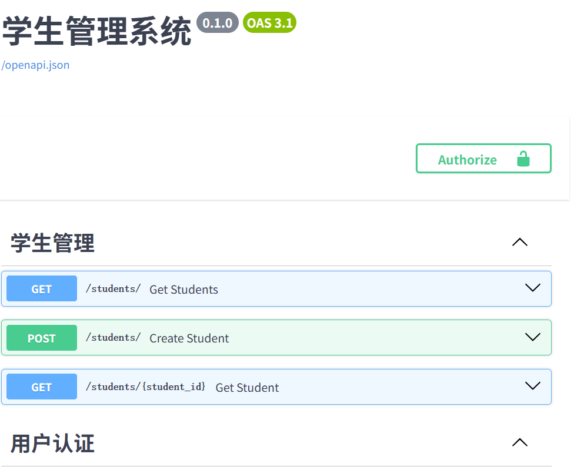
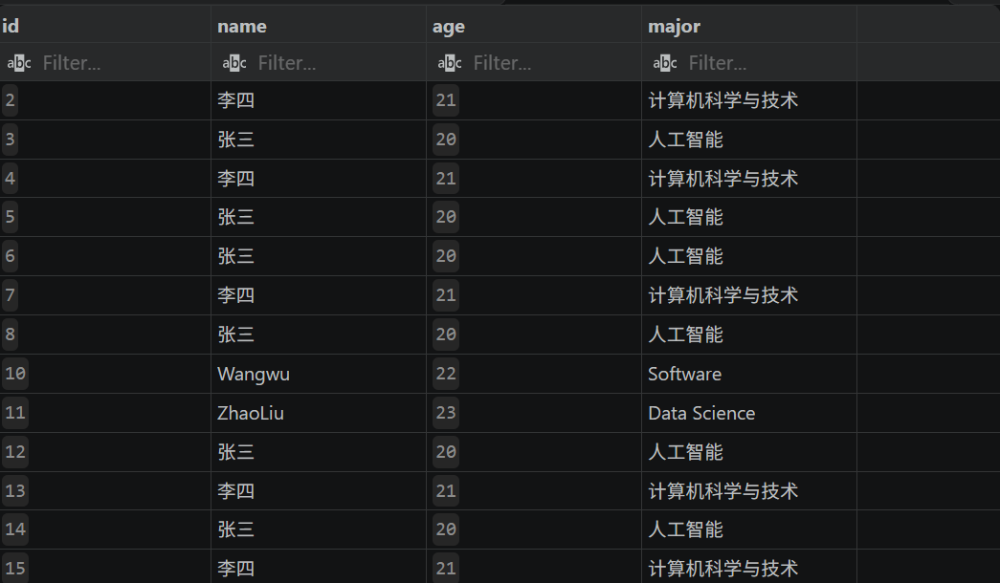
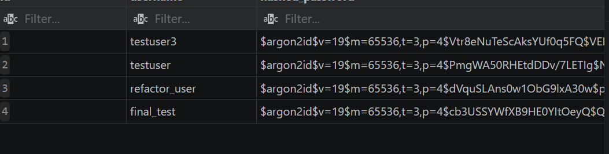
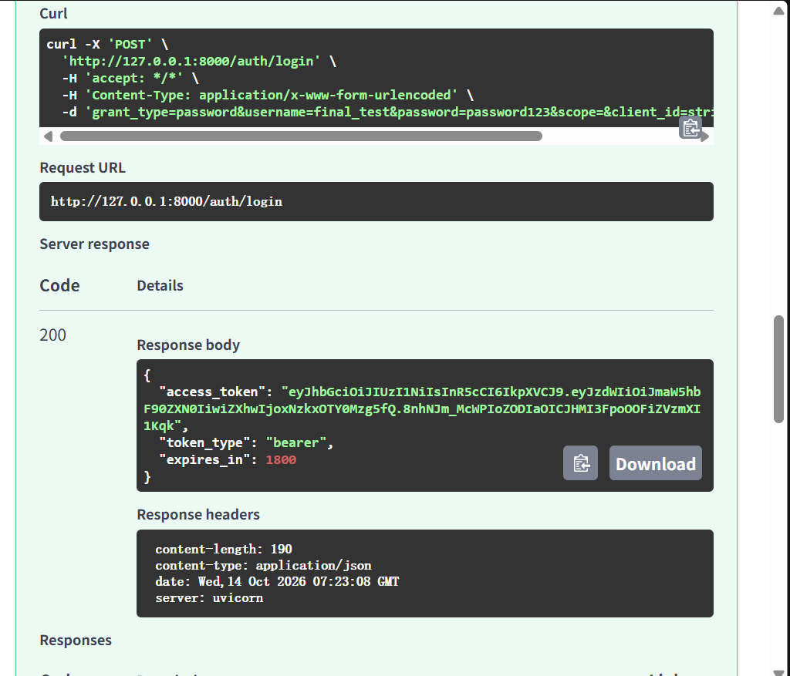

# FastAPI 学生管理系统

基于 FastAPI 开发的学生信息管理系统，实现用户注册登录、JWT 认证、MySQL 数据管理以及 Redis 缓存。

## 技术栈

- Python
- FastAPI
- SQLAlchemy
- MySQL
- JWT
- Redis
- Git

## 功能

- ✅ 用户注册
- ✅ 用户登录
- ✅ JWT 身份认证
- ✅ 学生信息 CRUD
- ✅ Redis 缓存查询
- ✅ Swagger 接口文档

## 快速开始

### 环境要求

- Python 3.10+
- MySQL 8.0+
- Redis（本地安装或 Docker）

### 1. 安装依赖

```bash
pip install -r requirements.txt
```

### 2. 配置数据库

编辑 [database.py](database.py)，把 `DATABASE_URL` 里的账号密码改成你自己的 MySQL 连接信息，并确保数据库 `school` 已创建。

### 3. 配置 Redis

确保 Redis 运行在本地 `6380` 端口（或修改 [redis_client.py](redis_client.py) 中的连接地址）。

用 Docker 启动 Redis：

```bash
docker run -d --name my-redis -p 6380:6379 redis
```

### 4. 启动服务

```bash
uvicorn main:app --reload
```

启动后访问：

- 接口文档（Swagger UI）：<http://127.0.0.1:8000/docs>
- 首页：<http://127.0.0.1:8000/>

## 项目结构

```
fastapi/
├── main.py              # 应用入口，注册路由
├── database.py          # 数据库连接与会话
├── redis_client.py      # Redis 连接
├── models/              # SQLAlchemy 数据模型
│   ├── student.py
│   └── user.py
├── routers/             # 接口路由
│   ├── student.py
│   └── auth.py
├── schemas/             # Pydantic 请求/响应模型
│   ├── student.py
│   └── user.py
├── services/            # 业务逻辑
└── requirements.txt     # 依赖清单
```

## 接口一览

| 方法 | 路径 | 说明 |
|---|---|---|
| POST | `/auth/register` | 用户注册 |
| POST | `/auth/login` | 用户登录，返回 JWT token |
| GET | `/auth/me` | 获取当前用户信息（需 token） |
| POST | `/students/` | 新增学生 |
| GET | `/students/` | 查询所有学生（走 Redis 缓存） |
| GET | `/students/{id}` | 查询单个学生 |
| PUT | `/students/{id}` | 修改学生 |
| DELETE | `/students/{id}` | 删除学生 |

## 截图

### Swagger 接口文档



### 数据库表 - students



### 数据库表 - users



### 登录成功返回 Token


