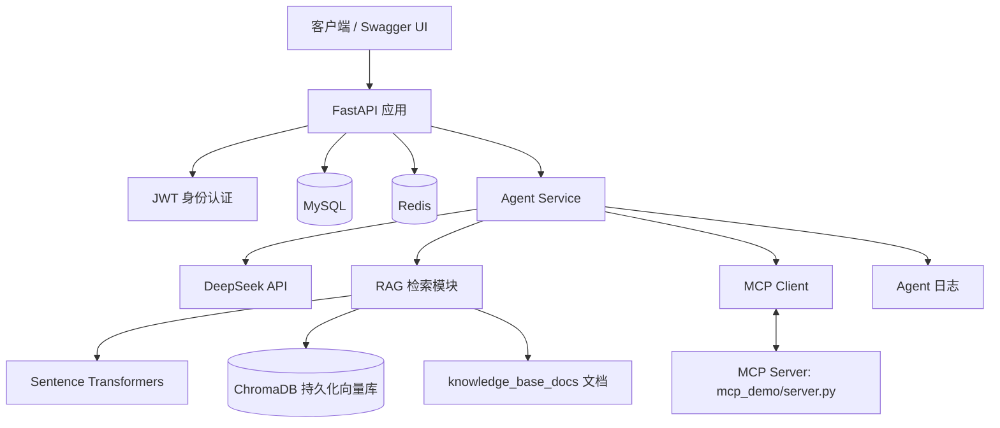

# FastAPI AI Agent 与知识库系统

一个以 FastAPI 为后端框架的学习与实践项目，整合学生管理 API、用户认证、Redis 缓存与会话记忆、基于向量检索的 RAG 知识库，以及通过 MCP 接入工具的 AI Agent。项目使用 Docker Compose 组织应用及其依赖服务。

说明： 具体接口字段、容器服务名、环境变量名和启动命令以本地代码及 `docker-compose.yml` 为准；未声称任何未经实际运行确认的测试结果。

## 目录

- [项目功能](#项目功能)
- [技术栈](#技术栈)
- [系统架构](#系统架构)
- [项目结构](#项目结构)
- [环境要求](#环境要求)
- [配置环境变量](#配置环境变量)
- [启动方式](#启动方式)
- [接口说明](#接口说明)
- [主要业务流程](#主要业务流程)
- [测试与验证](#测试与验证)
- [常见问题](#常见问题)
- [安全注意事项](#安全注意事项)
- [后续改进方向](#后续改进方向)

## 项目功能

### 1. 学生管理 API

- 使用 FastAPI 提供 HTTP API。
- 使用 SQLAlchemy 与 MySQL 持久化业务数据。
- 支持学生信息的新增、列表查询和按 ID 查询（路由定义见 `routers/student.py`）。
- 通过 Swagger UI 查看和调试接口。

### 2. 用户认证与授权

- 提供用户注册、登录及当前用户信息功能（见 `routers/auth.py`）。
- 使用 JWT 作为访问令牌。
- 对需要登录的 Agent 接口进行身份校验。
- Agent 会话与用户名关联，校验会话归属，避免不同用户直接访问彼此的会话记忆。

### 3. Redis 缓存与会话记忆

- 使用 Redis 缓存学生列表查询结果，减少重复访问数据库。
- 使用 Redis 保存 Agent 对话历史。
- 会话记忆设置过期时间（当前实现为 24 小时，见 `agent_memory.py`）。
- 提供会话记忆查询和删除能力（见 `routers/agent.py`）。

### 4. 大模型对话

- 通过 OpenAI 兼容 SDK 调用 DeepSeek API。
- 通过系统提示词约束 Agent 的角色与回答方式。
- 支持多轮工具调用流程；模型、轮数限制和错误处理见 `agent_service.py`。

### 5. RAG 知识库检索

- 从 `knowledge_base_docs/` 读取文本知识文档。
- 将文档拆分为文本块（chunking）。
- 使用 Sentence Transformers 生成向量。
- 使用 ChromaDB 持久化向量并执行相似度检索。
- 将检索到的相关内容提供给大模型，辅助生成更贴近本地知识库的回答。

RAG 的回答质量取决于文档内容、切分方式、Embedding 模型和检索参数，不应将检索结果视为必然正确。

### 6. MCP 工具调用

- 通过 MCP Python SDK 启动本地 MCP Server。
- 获取 Server 暴露的工具列表，并将工具信息转换为模型可用的工具定义。
- 在模型提出工具调用时执行对应工具，并将工具结果返回模型继续处理。
- 当前 MCP 服务端代码位于 `mcp_demo/server.py`，工具包括加法、乘法、术语解释等。

### 7. 日志与容器化

- Agent 服务记录请求标识、耗时、成功或失败等日志（见 `agent_logger.py` 和 `agent_service.py`）。
- 使用 Dockerfile 构建应用镜像。
- 使用 Docker Compose 管理应用、MySQL 和 Redis 等服务；服务名为 `app`、`mysql`、`redis`，应用映射宿主机 `8000` 端口。

## 技术栈

| 类别 | 技术 | 用途 |
|---|---|---|
| Web 框架 | FastAPI | 构建 REST API |
| ORM | SQLAlchemy | 数据库访问与模型映射 |
| 关系型数据库 | MySQL | 持久化用户和业务数据 |
| 缓存/会话 | Redis | 缓存、Agent 对话历史和会话归属信息 |
| 身份认证 | JWT | 用户身份校验 |
| 大模型 | DeepSeek API | 对话与工具调用决策 |
| 向量数据库 | ChromaDB | 保存和检索文档向量 |
| Embedding | Sentence Transformers | 文本向量化 |
| 工具协议 | MCP | 将外部工具提供给 Agent 调用 |
| 容器化 | Docker / Docker Compose | 构建和编排服务 |
| API 调试 | Swagger UI | 查看和调试接口 |
| 自动化测试 | pytest / HTTPX | 接口与权限测试 |

## 系统架构



### Agent 对话的典型流程

1. 客户端携带 JWT 调用受保护的 Agent API。
2. FastAPI 验证令牌，并确认请求访问的会话属于当前用户。
3. 服务读取 Redis 中的会话历史。
4. Agent 根据用户问题决定直接回答，或调用 RAG 检索、MCP 工具。
5. 工具结果返回模型，由模型组织最终答复。
6. 服务保存更新后的对话历史，并返回回答和会话标识。
7. 日志记录请求耗时和异常类别，便于排查问题。

## 项目结构

```
fastapi/
├── main.py                  # FastAPI 应用入口、lifespan 生命周期管理
├── database.py              # 数据库连接与 Session 配置
├── redis_client.py          # 学生缓存用的 Redis 连接
├── agent_memory.py          # Agent 会话历史、会话归属（Redis）
├── agent_service.py         # Agent、RAG 与 MCP 调用逻辑
├── agent_logger.py          # Agent 日志配置
├── ai_chat.py               # AI 对话路由 /chat
├── ai_extract.py            # AI 学生信息提取路由 /ai/extract-student
├── routers/                 # API 路由
│   ├── student.py           # 学生管理
│   ├── auth.py              # 注册、登录、JWT 认证
│   └── agent.py             # Agent 会话、对话与记忆
├── models/                  # SQLAlchemy 数据模型
├── schemas/                 # 请求与响应模型
├── services/                # 业务逻辑模块
├── mcp_demo/
│   ├── server.py            # MCP Server
│   └── skills/              # 技能说明
├── knowledge_base_docs/     # RAG 使用的知识文档
├── rag_docs/                # 早期 RAG Demo 的知识文档
├── tests/                   # 自动化测试
├── logs/                    # 运行日志（运行时生成）
├── knowledge_chroma_db/     # ChromaDB 持久化目录（运行时生成）
├── .env.example             # 环境变量模板
├── .env                     # 本地环境变量，不应提交
├── .gitignore
├── requirements.txt
├── Dockerfile
├── docker-compose.yml
└── init.sql                 # 数据库初始化脚本
```

## 环境要求

- Windows、macOS 或 Linux 均可；本项目开发过程使用 Windows + PowerShell。
- Python 版本需满足项目依赖要求（本地开发使用 Python 3.14）。
- Docker Desktop（或可运行 Docker Engine 的环境）用于 Compose 部署。
- DeepSeek API Key 用于调用大模型。
- 如在 Docker 外直接运行应用，需要本机可访问 MySQL 与 Redis；具体地址和端口取决于本地配置。

## 配置环境变量

在项目根目录创建 `.env` 文件（可参考 `.env.example`）。以下是本项目代码实际读取的变量：

```env
# 大模型 API（DeepSeek）
DEEPSEEK_API_KEY=替换为你自己的API密钥
DEEPSEEK_BASE_URL=https://api.deepseek.com
DEEPSEEK_MODEL=deepseek-chat

# Redis：本机运行与容器运行时地址不同
# 本地开发（宿主机）
REDIS_URL=redis://localhost:6380/0

# JWT 签名密钥
# 生成方式：python -c "import secrets; print(secrets.token_hex(32))"
SECRET_KEY=替换为随机生成的长密钥

# 可选：日志级别（DEBUG / INFO / WARNING / ERROR）
LOG_LEVEL=INFO
```

数据库配置方面，`database.py` 读取的是以下变量（不读 `DATABASE_URL`）：

```env
DB_HOST=localhost
DB_PORT=3306
DB_USER=root
DB_PASSWORD=你的数据库密码
DB_NAME=school
```

容器内部互相访问时，应使用 Compose 服务名作为主机名（如 `mysql`、`redis`）；宿主机访问容器则使用映射到宿主机的端口。`docker-compose.yml` 已在应用服务中覆盖了容器内的 `REDIS_URL`，因此 `.env` 中的本地地址不会影响容器运行。

### 安全要求

- 不要把真实 `.env` 上传到 GitHub。
- 确认 `.gitignore` 已忽略 `.env`、日志文件和运行时向量数据库目录。
- 不要把 API Key、数据库密码或 JWT 密钥写进 README、源代码或截图。
- 如果密钥曾被提交到公开仓库或发送到不可信位置，应尽快轮换；仅从最新代码中删除并不能让旧密钥失效。

## 启动方式

### 方式一：使用 Docker Compose

1. 安装并启动 Docker Desktop。
2. 在项目根目录准备 `.env`。
3. 检查最终 Compose 配置：

   ```bash
   docker compose config
   ```

4. 构建并启动服务：

   ```bash
   docker compose up -d --build
   ```

5. 查看容器状态与日志：

   ```bash
   docker compose ps
   docker compose logs --tail=100
   docker compose logs -f app
   ```

6. 应用映射宿主机 `8000` 端口，浏览器打开 <http://127.0.0.1:8000/docs>。

停止服务但保留数据：

```bash
docker compose stop
```

移除容器和网络（是否保留数据取决于卷设置）：

```bash
docker compose down
```

> 不要在不了解数据影响时使用 `docker compose down -v`，它会删除 Compose 管理的命名卷，可能导致数据库数据丢失。

### 方式二：在本机 Python 环境运行

仅在已安装依赖、`.env` 配置正确且 MySQL/Redis 可访问时使用。

```powershell
cd C:\Users\10645\Desktop\fastapi

# 激活虚拟环境（如果项目已有 .venv）
.\.venv\Scripts\Activate.ps1

# 安装依赖
python -m pip install -r requirements.txt

# 启动服务（本地用 8001，避免与 Docker 占用的 8000 冲突）
python -m uvicorn main:app --reload --port 8001
```

然后打开 <http://127.0.0.1:8001/docs>。

> 应用启动时会在 lifespan 中初始化 RAG 知识库并连接 MCP Server，首次启动可能需要额外时间（包括下载 Embedding 模型），请以终端日志为准。

## 接口说明

实际路径与请求字段应以 `main.py`、`routers/` 中的路由定义及 `/docs` 为准。

| 功能 | 说明 | 认证要求 |
|---|---|---|
| 学生管理 | 新增、列表查询、按 ID 查询 | 以实际路由配置为准 |
| 用户注册 | 创建用户账号 | 无需已有令牌 |
| 用户登录 | 验证账号并获取 JWT | 使用登录凭据 |
| 当前用户 | 获取当前登录用户信息 | 需要有效 JWT |
| Agent 健康检查 | 检查 Redis 连接状态 | 无需令牌 |
| 创建 Agent 会话 | 创建会话并记录会话所有者 | 需要有效 JWT |
| Agent 对话 | 让 Agent 回答问题并按需调用工具 | 需要有效 JWT |
| 读取会话记忆 | 查看当前用户有权访问的会话历史 | 需要有效 JWT，并校验会话归属 |
| 删除会话记忆 | 删除对应会话历史及所有者记录 | 需要有效 JWT，并校验会话归属 |

## 主要业务流程

### JWT 认证流程

1. 用户注册或使用已有账号登录。
2. 登录接口验证凭据并签发 JWT。
3. 客户端在需要认证的请求中携带令牌。
4. 后端校验令牌并确定当前用户。
5. 对 Agent 会话接口，后端检查会话所有者，避免只验证"已登录"而未验证"是否有权访问该会话"。

### RAG 检索流程

1. 从 `knowledge_base_docs/` 加载文本文件。
2. 将文档切分成较小的文本块。
3. 使用 Embedding 模型把文本转换为向量。
4. 把文本及向量写入 ChromaDB。
5. 用户提问时，对问题进行向量化并检索相关文本块。
6. 把检索结果与问题一起提供给大模型，生成回答。

### MCP 工具调用流程

1. Agent 启动时连接 MCP Server。
2. 客户端读取 Server 暴露的工具描述。
3. Agent 将可用工具信息提供给大模型。
4. 模型请求调用工具时，后端执行对应 MCP 工具。
5. 工具返回结果后，后端把结果交回模型，生成最终回复。
6. 达到工具调用轮数限制或出现异常时，按当前实现返回错误或结束处理。

## 测试与验证

README 不预设测试已经通过。建议部署后按实际情况逐项验证，并记录执行日期、命令和结果。

### 容器与服务

```bash
docker compose ps
docker compose config --services
docker compose logs --tail=100
```

### API 文档

打开应用实际映射的 `/docs` 地址，检查路由是否出现，并分别验证正常请求和异常请求。

### 建议覆盖的检查项

- [ ] 应用容器启动，日志中没有未处理的启动异常。
- [ ] MySQL 健康状态正常，应用能够访问数据库。
- [ ] Redis 可连接，缓存读写行为符合预期。
- [ ] 学生数据可以按接口定义查询和新增。
- [ ] 注册、登录和 JWT 令牌校验符合预期。
- [ ] 未携带令牌访问受保护的 Agent 接口时会被拒绝。
- [ ] 用户 A 不能读取或删除用户 B 的会话记忆。
- [ ] RAG 能检索到知识库文档中的相关内容。
- [ ] MCP 工具能被发现并按接口定义调用。
- [ ] Agent 日志能够记录成功请求和异常。
- [ ] 重启容器后，需要持久化的数据仍然存在。

### pytest

```bash
python -m pytest -v
```

如果测试会触发 FastAPI lifespan，而 lifespan 会连接外部服务、重建向量库或启动 MCP Server，应为测试环境提供隔离配置或在测试中 mock 相关依赖。不要仅凭测试文件存在就宣称测试通过。

## 常见问题

### 1. 容器内无法连接 MySQL 或 Redis

容器内的 `localhost` 指当前容器自身，不是另一个 Compose 服务。应用在 Compose 网络中应使用 `docker-compose.yml` 中定义的服务名和容器端口；宿主机访问则使用端口映射。

### 2. Redis 连接失败

- 确认 Redis 容器运行状态与端口映射。
- 检查 `REDIS_URL` 是否与当前运行方式匹配。
- 本机运行和容器运行的 Redis 地址可能不同。
- 检查是否存在本地文件命名为 `redis.py`，这可能遮蔽第三方 `redis` 包。

### 3. DeepSeek API 调用失败

- 检查 `.env` 中的 API Key 是否正确，并确认应用实际加载了该文件。
- 检查网络连接、账户额度及 API 服务状态。
- 确认 Docker Compose 将所需环境变量传入应用容器。
- 不要将完整密钥粘贴到公开日志或问题截图中。

### 4. RAG 找不到相关内容

- 检查 `knowledge_base_docs/` 中是否有支持格式的文本文件。
- 确认应用读取的是预期目录。
- 检查文档切分、Embedding 模型加载与 ChromaDB 初始化日志。
- 检索结果不理想时，可评估 chunk 大小、重叠长度、召回数量及重排策略。

### 5. MCP Server 无法启动

- 检查 `mcp_demo/server.py` 路径是否正确。
- 确认 MCP 相关依赖安装在应用实际使用的 Python 环境中（注意当前使用 1.x 版本）。
- 查看应用日志中子进程启动、工具初始化和连接阶段的异常。

### 6. 中文显示乱码

检查数据库、连接字符集、表字符集和初始化 SQL 是否统一使用 `utf8mb4`。如果使用初始化脚本，确认它只在预期的数据库初始化场景执行。

## 安全注意事项

- `.env` 和真实密钥不要提交到代码仓库。
- 对外部署时，不要把开发用的调试模式直接暴露到公网。
- 生产环境应使用强随机 JWT 密钥，并配置合理的令牌有效期与密钥轮换方式。
- 会话 ID 不应被视为授权凭据；访问会话前必须进行身份和所有权校验。
- 对日志中的令牌、密码、API Key、个人信息进行脱敏。
- 对公网服务配置访问控制、HTTPS、请求限流、输入校验与依赖更新策略。
- 不要在未确认备份的情况下删除 Docker 数据卷或数据库文件。

## 后续改进方向

- 为认证、会话隔离、RAG 和 MCP 工具执行补充可重复的自动化测试。
- 将数据库初始化、迁移和测试数据管理流程规范化。
- 优化 RAG 的增量索引、元数据过滤、检索评估和重排机制。
- 为 Agent 工具调用增加超时、重试策略、参数校验与权限控制。
- 为健康检查区分应用存活状态和依赖服务就绪状态。
- 完善日志脱敏、结构化日志、监控和异常告警。
- 录制一段演示视频，并在 README 中加入真实截图、接口示例和实际测试结果。

## 许可证

本项目尚未在此 README 中指定许可证。若计划公开或允许他人复用，请根据实际需求添加合适的 LICENSE 文件，并确认依赖及示例代码的使用条件。
